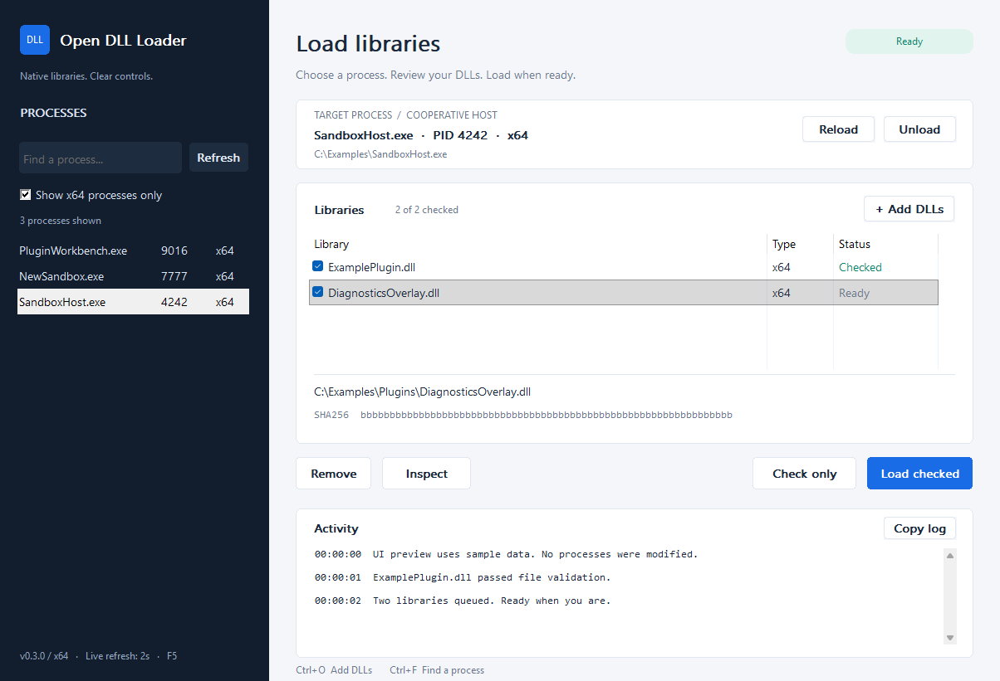

# Open DLL Loader

[](https://github.com/Nnamllit1/open-dll-loader/actions/workflows/build-release.yml)

A small MIT-licensed C++ toolkit for plugin development: a Windows DLL loader with a desktop interface and CLI, plus a cooperative hot-reload host for Windows and native Linux. Use it with processes and plugins you own or are authorized to modify.



## Version 0.4.0

A Linux game picker now discovers initialized Proton games across native Steam, Flatpak Steam, and configured library folders. It marks running games, refreshes every five seconds, and opens the Windows loader for the selected game through Protontricks. The Linux Proton package includes both Windows architectures; it uses the game's existing prefix instead of starting the demo host. See the [game-picker instructions](linux/README.md).

The process list now refreshes in the background every two seconds, preserving the current filter and process identity. Reload and Unload controls are available for cooperating hosts. The included host can watch a rebuilt DLL, stage an unlocked copy, preserve host-owned state, and stop the old plugin before replacement.

The desktop interface also provides an architecture filter, a DLL queue with individual results, file paths and checksums, read-only inspection, and a timestamped activity log. Actions become available when their required selections are ready. The layout supports resizing and per-monitor DPI scaling.

| Platform | Available component |
| --- | --- |
| Windows x64/x86 | Native GUI, CLI, demo launcher, and cooperative host |
| Native Linux x64 | Portable CLI host and `.so` plugin examples; no native desktop injector |
| Wine | Windows binaries, with a separate CI smoke-test job |
| Proton | Linux game picker and bundled Windows loaders via Protontricks; actual Steam/Proton validation remains separate |

See [Linux/Wine/Proton](docs/linux-wine-proton.md) and the [cooperative hot-reload example](https://github.com/Nnamllit1/open-dll-loader/tree/main/examples/reloadable-host). Windows 10 version 1511 or later is required for the native desktop build.

## Download

[GitHub Releases](https://github.com/Nnamllit1/open-dll-loader/releases) provides Windows x64/x86 ZIPs, a Linux Proton game-picker archive, and a separate native Linux host archive. Extract a Windows ZIP and start `x64/odl-demo-launcher.exe` or `x86/odl-demo-launcher.exe` for the example, or start `OpenDllLoader.exe` in that same architecture directory. Windows packages include `docs/hot-reload.md` and the Wine/Proton guide.

For an existing Steam game on Linux, extract `OpenDllLoader-linux-proton.tar.gz`, install Python 3.10+, Tkinter, and [Protontricks](https://github.com/Matoking/protontricks#installation), and run `./odl-proton`. Start the game through Steam, select it in the picker, and click **Open loader for this game**. Select the target process and DLL in the Windows loader after it opens. Prefix discovery does not guarantee that the game permits loading.

The Linux archive contains `odl-plugin-host` and sample `.so` files at its root. Run `./odl-plugin-host --plugin "$PWD/reloadable-plugin-v1.so" --watch`. Prebuilt Linux artifacts are built on Ubuntu 24.04 and need a compatible system runtime; build from source on other environments when necessary. Paths beginning with `dist/` below refer to local source builds.

## Use

1. Start `dist/x64/OpenDllLoader.exe` for a 64-bit target, or `dist/x86/OpenDllLoader.exe` for a 32-bit target.
2. Find the target in the process sidebar by name, PID, or executable path. The architecture filter initially shows compatible processes. Select the process and review its path in the target card.
3. Click **Add DLLs...** or drop DLL files onto the window. Check the files to load.
4. **Inspect** produces a read-only report for the selected DLL. **Check only** validates the checked files, architecture, process identity, and required access without modifying the target. **Load checked** loads the checked files in their listed order.

Each queue row shows its current result. Select a row to see the full path and SHA-256. **Remove** changes the queue only; it does not unload code. **Copy log** copies the activity text for troubleshooting.

Keyboard shortcuts: **Ctrl+F** focuses process search, **Ctrl+O** adds DLLs, **F5** refreshes processes, and **Delete** removes the selected queue row when the queue has focus.

The log includes each DLL's SHA-256 and the load result. A checksum identifies a file; it does not establish that its code is trustworthy. DLL code runs inside the target with its permissions and can crash or damage it. Use a disposable test process first.

The executable uses your existing privileges. A denied operation is reported; the program does not enable debug privileges or change security settings. Protected or incompatible targets can reject loading. Native DLL dependencies must already be available to the target's Windows loader.

## Reload without restarting a cooperating host

Start `dist/x64/odl-demo-launcher.exe`, select `odl-plugin-host.exe`, and use its **Reload** or **Unload** buttons. The launcher also starts watch mode for `active-plugin.dll`; rebuilding or replacing that source file reloads the sample without closing its host. **Remove** only removes a queue entry; **Unload** asks the cooperating host to stop and unload its own plugin.

An arbitrary injected DLL may still own threads or callbacks, so it cannot be safely unloaded through a generic remote `FreeLibrary` call. Hot reload requires the explicit `start`/`tick`/`stop` ABI in the example. A stop refusal keeps the module loaded. The source DLL remains writable because the host loads a temporary copy. The host exposes its own plugin through a local control pipe; it does not expose arbitrary function execution or DLL paths to the controller.

CLI examples in PowerShell:

```powershell
.\dist\x64\open-dll-loader.exe --list
.\dist\x64\open-dll-loader.exe --inspect C:\Mods\MyPlugin.dll
.\dist\x64\open-dll-loader.exe --diagnose 1234 C:\Mods\MyPlugin.dll
.\dist\x64\open-dll-loader.exe --check 1234 C:\Mods\MyPlugin.dll
.\dist\x64\open-dll-loader.exe --load 1234 C:\Mods\MyPlugin.dll C:\Mods\OtherPlugin.dll
.\dist\x64\open-dll-loader.exe --host-status 1234
.\dist\x64\open-dll-loader.exe --reload 1234
.\dist\x64\open-dll-loader.exe --unload 1234
```

`--check` does not guarantee that DLL initialization will succeed. A batch stops at its first failed or indeterminate result; earlier successful loads remain in the target. An already loaded DLL at the expected path is skipped. There is no forced unload: stopping a plugin safely requires its own lifecycle contract, or exiting the target.

## Read-only inspection

**Inspect** reads the DLL's native PE headers and direct import names. If a process is selected, it also queries available Windows image signature restrictions and reports architecture compatibility. It does not execute the DLL, start a remote thread, or modify process memory. The CLI equivalent is `--diagnose PID DLL`; use PID `0` for a file-only report.

This report is not a full dependency resolver. It does not validate transitive or delay-loaded dependencies, reconstruct API-set/manifest resolution, or determine whether `DllMain` will succeed. A file beside the DLL is identified as such, without claiming the target will find or load it. Windows searches dependencies separately from the selected DLL's absolute path; see [Microsoft's DLL search-order documentation](https://learn.microsoft.com/en-us/windows/win32/dlls/dynamic-link-library-search-order).

The message that the expected DLL was not found in the module list does not identify its cause. Missing dependencies, initialization failure, process policy, or an unsuccessful verification can produce this result. This version does not recover the remote thread's `GetLastError` value and does not bypass loading restrictions.

## Behavior and limits

The complete loader is in `src/loader.cpp`. It validates native PE headers and SHA-256 while holding a read handle that denies file writes and deletion. Loader, target, and DLL must all use the same architecture. A process creation timestamp guards against selecting a reused PID.

Loading uses the documented Windows APIs `OpenProcess`, `VirtualAllocEx`, `WriteProcessMemory`, and `CreateRemoteThread`, with `LoadLibraryW` as the thread entry. Only the DLL path is written to the target; its allocation is readable/writable, never executable. The function address is resolved against the actual owning Windows module in the target, accounting for forwarded exports and different module bases. Success requires finding the expected full DLL path in the target's normal module list. The DLL remains visible there.

The remote thread gets a 15-second wait. If it has not finished or its status cannot be established, the result is indeterminate. The small path allocation is retained until target exit rather than freeing memory a live thread might still use. The program does not terminate that thread. Inspect or restart the target before retrying.

This version supports manual loading, multiple checked DLLs, drag and drop, process selection, input validation, and command-line use. It does not implement auto-injection, managed DLL hosting, exported-function calls, manual mapping, thread hijacking, scrambling, module hiding, header erasure, or driver loading. It makes no network requests and installs no services, startup entries, or dependencies.

Antivirus software can classify DLL loaders as hacktools even when all source is available. This project does not promise detection-free binaries. Keep protection enabled; disputed detections can be submitted to [Microsoft for analysis](https://www.microsoft.com/en-us/wdsi/filesubmission). The project does not add exclusions or alter Defender.

## Build and test

Install Visual Studio 2022 with **Desktop development with C++**, the Windows SDK, CMake, and Python 3 for the lifecycle regression tests. There are no downloaded C++ library dependencies.

```powershell
.\build.cmd                    # x64 and x86; builds and runs isolated tests
.\build.cmd x64
```

The script writes binaries and SHA-256 checksums under `dist/`. Set `ODL_DIST` to a separate absolute directory to stage a build without replacing an open copy of the loader. It works with the default PowerShell execution policy. `build.ps1` is also available for environments that permit local PowerShell scripts. Tests build a tiny source-controlled DLL, launch a new child of the CLI, load the DLL into that child, and require a DLL initialization acknowledgment. They also exercise dry-run behavior, stale identity rejection, architecture rejection, missing files, executable rejection, repeated loading, and exited targets. No existing application is selected by the test.

A separate native UI test uses sample processes and libraries to check search, selection, architecture filtering, checkbox handling, button states, queue removal, and error presentation. It renders empty, populated, compact, failure, and 150% scale layouts for visual review. It does not load DLLs or modify another process. The desktop automation helper is not required for this test.

Cooperative host tests also check shadow-copy replacement, preserved state, bad rebuilds, unload/reload, watch mode, stop refusal, and the Windows GUI control protocol. The native Linux build compiles this host and its plugin examples only:

```bash
cmake -S . -B build/linux -DCMAKE_BUILD_TYPE=Release
cmake --build build/linux --parallel 4
ctest --test-dir build/linux --output-on-failure
```

## CI and automatic releases

GitHub Actions builds and tests Windows x64/x86 and the native Linux host, then runs the Windows test binaries under Wine. It also checks the Linux game picker's discovery, UI, and combined package. Build artifacts and test reports are attached to each run. A `v<version>` tag must match `CMakeLists.txt`; after every required job passes, the workflow publishes Windows ZIPs, the Linux Proton package, the native Linux host archive, and SHA-256 checksums as a GitHub release. Actual Steam/Proton compatibility is a separate manual check, not inferred from Wine or fixture tests.

To run CMake directly:

```powershell
cmake -S . -B build/x64 -G "Visual Studio 17 2022" -A x64
cmake --build build/x64 --config Release
ctest --test-dir build/x64 -C Release --output-on-failure
```

Published binaries should carry checksums and identify their source version. Local builds are unsigned. A local Defender scan is only evidence for that engine, signature set, and time; it cannot establish universal safety or future antivirus behavior.
